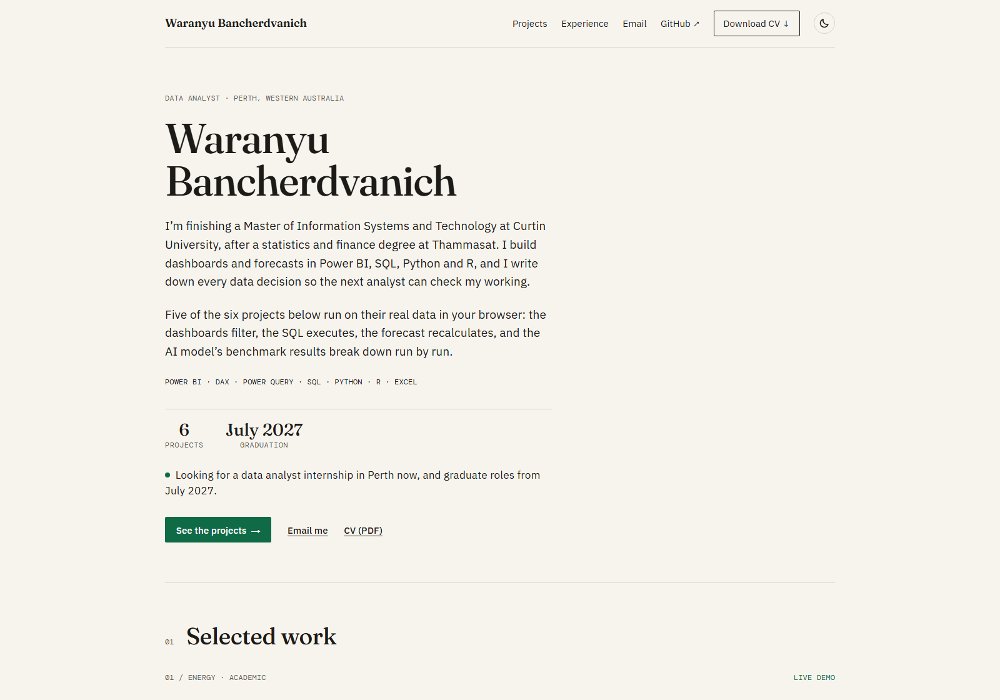
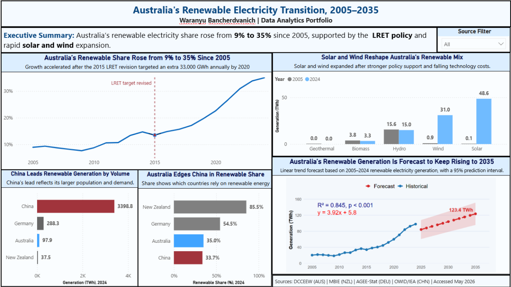
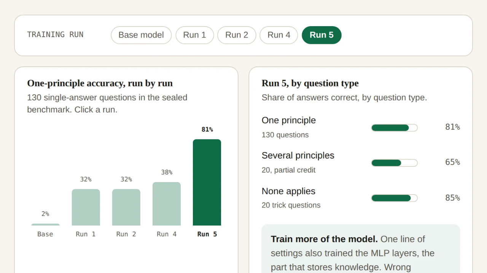
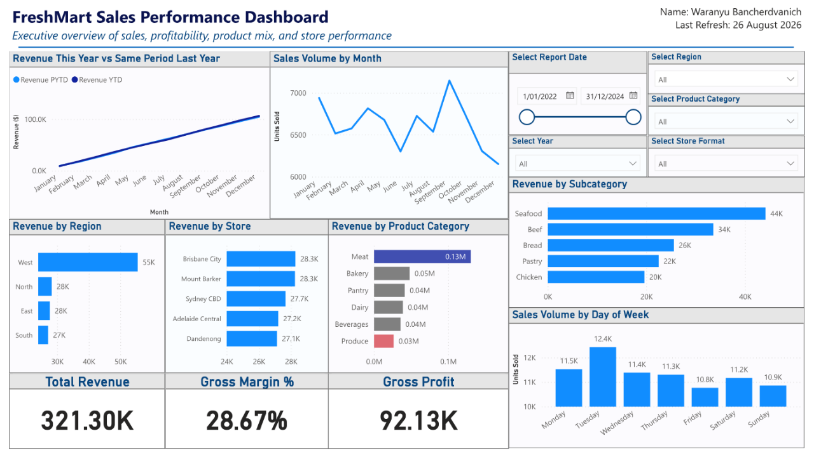
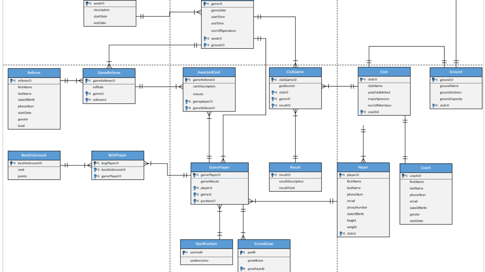
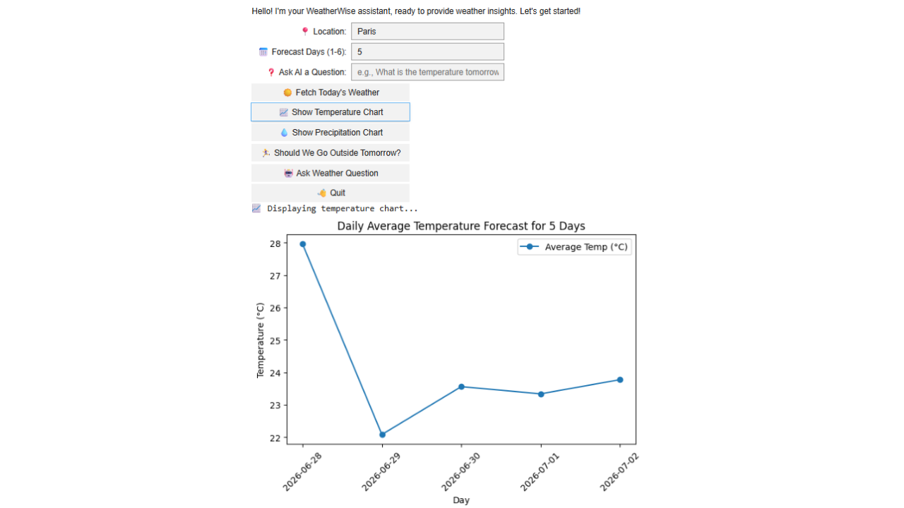
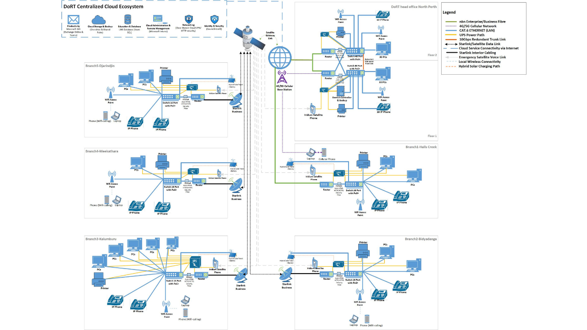

<h1 align="center">Hi, I'm JO 👋</h1>

  Data analyst working in BI and visualisation. 
  Master of Information Systems and Technology at Curtin University, with a background in statistics and finance. 
  I build dashboards, data models, and forecasts that turn messy data into decisions people can defend.

  
  
  

 

  

<h3 align="center"><a href="https://waranyu-cv.vercel.app">waranyu-cv.vercel.app</a></h3>

  My portfolio. Every project below has a full case study there, 
  with live dashboards and SQL queries you can run in the browser, not just screenshots.

---

## 🛠️ Tools

  
  
  
  
  
  
  

**Modelling:** ERD · normalisation · star and galaxy schema · time-series forecasting · model evaluation

---

## 📊 Featured projects

<table>
<tr>
<td width="50%" valign="top">

<h3>⚡ Australia's renewable transition</h3>

Traced Australia's renewable share from <b>9% in 2005 to 35% in 2024</b>. An R linear regression (R² ≈ 0.85, p &lt; 0.001) forecasts only <b>37.8% by 2030</b> against the 82% target. The share stalled during the Renewable Energy Target review, then grew about 2.5 points a year after the 2015 reset, nearly 5× its 2005 to 2015 pace.

<code>Power BI</code> <code>DAX</code> <code>R</code> <code>Forecasting</code>

  <a href="https://waranyu-cv.vercel.app/renewable.html"><b>Case study →</b></a> ·
  <a href="https://github.com/jo-bancherdvanich/renewable-electricity-dashboard">Repository</a>

</td>
<td width="50%" valign="top">

<h3>🤖 LocoLLM privacy-law adapter</h3>

Client capstone for LocoLabo at Curtin. Trained a small AI model that runs on an ordinary laptop into an Australian privacy-law specialist, and proved it on a <b>sealed 170-question benchmark</b>. Training the MLP layers lifted one-principle accuracy from <b>2% to 81%</b>. My role: Quality and Documentation Manager.

<code>Python</code> <code>LoRA fine-tuning</code> <code>Benchmark design</code>

  <a href="https://waranyu-cv.vercel.app/locollm.html"><b>Case study →</b></a> ·
  <a href="https://github.com/michael-borck/loco-llm">LocoLLM on GitHub</a>

</td>
</tr>
<tr>
<td width="50%" valign="top">

<h3>🛒 FreshMart data warehouse</h3>

Modelled <b>17,697 transaction lines</b> from 5,000 transactions across 60 products, 12 stores and 21 promotions into a Kimball star schema. Audited five source tables in Power Query first: removed 15 duplicate customers, collapsed 13 category spellings to 6, rebuilt dates written three ways, and remapped 93 rows with an unmatched customer ID. Found that Meat drives <b>40.6% of revenue</b>.

<code>Power BI</code> <code>Power Query</code> <code>DAX</code> <code>Star schema</code>

  <a href="https://waranyu-cv.vercel.app/freshmart.html"><b>Case study →</b></a> ·
  <a href="https://github.com/jo-bancherdvanich/freshmart-data-warehouse">Repository</a>

</td>
<td width="50%" valign="top">

<h3>⚽ Football club database</h3>

Turned <b>18 business rules</b> into an ERD and a normalised <b>16-table Oracle schema</b>, with a data dictionary and sample data checked in Excel before loading. Wrote <b>9 analytical queries</b>: season ladder, top scorers, goals per ground and best on ground. Three-person group project.

<code>Oracle SQL</code> <code>ERD</code> <code>Normalisation</code>

  <a href="https://waranyu-cv.vercel.app/football-database.html"><b>Case study →</b></a> ·
  <a href="https://github.com/jo-bancherdvanich/soccer-competition-database">Repository</a>

</td>
</tr>
<tr>
<td width="50%" valign="top">

<h3>🌦️ WeatherWise</h3>

An interactive weather advisor built in a Jupyter notebook. One cached call to the OpenWeatherMap API returns a 5-day forecast in 3-hour blocks, charted with Matplotlib and ipywidgets controls. It answers plain-language questions, and I fixed a bug where "tomorrow" was reading today's readings.

<code>Python</code> <code>Matplotlib</code> <code>ipywidgets</code> <code>REST API</code>

  <a href="https://waranyu-cv.vercel.app/weatherwise.html"><b>Case study →</b></a> ·
  <a href="https://github.com/jo-bancherdvanich/Weatherwise_Waranyu.B">Repository</a>

</td>
<td width="50%" valign="top">

<h3>🛰️ IT infrastructure plan</h3>

Pair project: connecting a Perth head office to five remote WA training centres. Compared <b>5 WAN options</b> and chose Starlink over Sky Muster on latency, about <b>29.8 ms against 664.9 ms</b>, so VoIP calls work. Designed solar, UPS and satellite-phone backup for outages, and drew the network diagram in Visio.

<code>Network design</code> <code>Visio</code> <code>Excel</code>

  <a href="https://waranyu-cv.vercel.app/infrastructure.html"><b>Case study →</b></a>

</td>
</tr>
</table>

---

## 📫 Reach me

  
  
  

---
